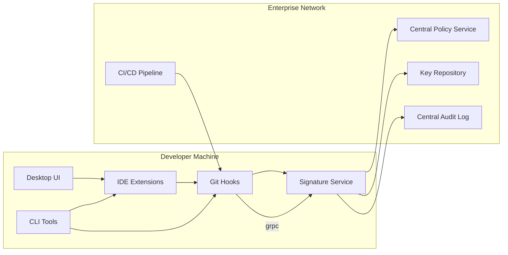

# 🛡️ Quantum-Safe Git (QSGit)

> **Quantum-Safe Git** (QSGit) is a revolutionary, future‑proof enhancement to Git that integrates **post‑quantum cryptographic signatures** (e.g., Dilithium, Falcon) into every commit, ensuring **code integrity** even against **future quantum computers**.

> **Now** is the time to protect your software supply chain against tomorrow’s threats—before it’s too late.

## 🔐 Why Quantum-Safe Git?

Traditional Git signing (GPG/S/MIME) relies on classical cryptography—secure until broken by powerful quantum machines predicted to arrive within a decade. Once they arrive, signed commits could become **forgable**, breaking the chain of trust across open‑source ecosystems, DevOps pipelines, and enterprise codebases.

**Quantum-Safe Git** prepares for this threat **today** by replacing those signatures with **post‑quantum algorithms** (NIST‑standardized CRYSTALS‑Dilithium, Falcon, etc.). Every commit becomes unforgeable now—and stays that way forever.

Whether you’re protecting mission‑critical software, contributing to open‑source, or enforcing DevSecOps compliance, your code deserves cryptographic resilience beyond tomorrow.


## 🔗 Project Links

- **GitHub Repository:** `[https://github.com/your‑org/quantum‑safe‑git]`
- **Documentation:** `[https://your‑org.github.io/quantum‑safe‑git]`
- **Community Slack:** `[invite‑link]`
- **Contribution Guidelines:** `[CONTRIBUTING.md]`


## 📋 Quick Overview

| Feature | Benefit |
|---------|---------|
| **Quantum‑Safe Signing** | NIST‑approved PQC algorithms for future‑proof security |
| **Zero‑Trust Integration** | Automatic signatures, enforced verification |
| **Enterprise‑Grade Scalability** | Handles thousands of repos, high‑volume pipelines |
| **Universal IDE Support** | Native editors, live‑feedback for developers |
| **Hardware‑Backed Keys** | YubiKey, TPM, cloud KMS for key security |
| **Complete Audit Trail** | Immutable logs and blockchain‑ready reporting |


## 🛠️ Development Environment Setup

### Prerequisites
- **Docker** – for the signature service and local development stack
- **Rust** (`cargo`) – for the Git hook plugin and LSP server
- **Go** (`go`) – for the signature service and CLI tools
- **Node.js** (`npm`) – for the Desktop UI and IDE extensions
- **VS Code** – with recommended extensions

### Setup Steps
1. Clone the repository
2. Start backend services (`docker compose up -d`)
3. Install the Git hook plugin
4. Build and run the signature service
5. Build and run the CLI verification tool
6. Run the Desktop UI

### Pre-commit Hooks
- Install and configure pre-commit hooks for linting and formatting.

### Gitpod / SpaceVim
- Configure cloud development environment (Gitpod) and editor (SpaceVim) for local development.


## 🧭 Project Structure Overview

```
quantum-safe-git/
├─ docs/                     # Architecture & design docs
├─ keys/                     # Private keys → .gitignore
│   ├─ user1/
│   └─ hardware/
├─ rust/                     # Git‑hook plugin
│   ├─ src/
│   │   ├─ lib.rs
│   │   ├─ git_hook.rs
│   │   ├─ signature.rs
│   │   └─ keymgr.rs
│   ├─ Cargo.toml
│   └─ tests/
│       └─ integration.rs
├─ go/                       # Signature Service (gRPC)
│   ├─ main.go
│   ├─ signature/
│   │   ├─ service.go
│   │   └─ proto/
│   ├─ keymgmt/
│   │   ├─ kms.go
│   │   └─ tpm.go
│   └─ cmd/
│       ├─ qsg-verify/
│       └─ qsg-genkey
├─ python/                   # Helper scripts
│   ├─ qsg_cli.py
│   └─ requirements.txt
├─ ui/                       # Desktop app (Electron)
│   ├─ package.json
│   ├─ src/
│   │   ├─ components/
│   │   ├─ hooks/
│   │   └─ services/
│   └─ preload.js
├─ docker/                   # Containerization
│   ├─ Dockerfile.signature
│   └─ docker-compose.yml
├─ ci/                       # CI integrations
│   ├─ github-action/
│   │   └─ action.yml
│   ├─ gitlab-ci/
│   │   └─ .gitlab-ci.yml
│   └─ jenkins/
│       └ - Jenkinsfile
├─ scripts/                  # Misc scripts
│   ├─ gen_key.sh
│   ├─ sign_all.sh
│   └─ verify_repo.sh
├─ docs/                     # Full documentation
│   ├─ README.md
│   ├─ ARCHITECTURE.md
│   └─ USER_GUIDE.md
├─ .github/
│   ├─ workflows/
│   │   └─ qsg-verify.yml
│   └─ CODEOWNERS
├─ .gitignore
└─ LICENSE
```


## 🛠️ Tech Stack

| Layer | Technology | Why? |
|-------|------------|------|
| **Programming** | Rust, Go, TypeScript | Speed, safety, cross‑platform |
| **Crypto** | liboqs, Dilithium, Falcon | NIST‑approved post‑quantum |
| **Git Extension** | libgit2 bindings (Rust) | Fast, native Git integration |
| **API** | gRPC (protobuf) | Low‑latency, language‑agnostic |
| **Backend Service** | Go + Gin | High‑performance, easy clustering |
| **UI** | Electron + React + TypeScript | Desktop & web with native look |
| **IDE** | Language Server Protocol extensions | Native editor integration |
| **Infra** | Docker + Kubernetes | Portable, scalable, CI/CD friendly |
| **Logging** | Elasticsearch + Kibana | Observability & audit trails |
| **Monitoring** | Prometheus + Grafana | Real‑time metrics & alerts |
| **CI** | GitHub Actions, GitLab CI, Jenkins | Multi‑platform integration |


## 📖 Architecture Overview



**Key Flow**
1. **Git Hooks (Rust)** intercept commit/push/tag events.
2. **Signature Service (Go)** signs/verifies with PQC and logs.
3. **IDE Extensions & Desktop UI** give live verification feedback.
4. **CI/CD** auto‑verifies signatures before merge.
5. **Enterprise Layer** centralizes keys, policies, and audit logs.


## 📋 Detailed Implementation Roadmap

**Timeline:** 12 months, split into 4 phases.

### Phase 1 – Foundation & Core Functionality (Months 1–3)

| Month | Goals |
|-------|-------|
| **1** | • Scaffold Rust & Go projects. <br>• Implement baseline Dilithium signing. <br>• Build Go gRPC signature service. <br>• Dockerize both components. |
| **2** | • Git hooks that auto‑sign commits. <br>• Local verification CLI (`qsg-verify`). <br>• Hardware‑key support (YubiKey/TPM). <br>• Initial Electron UI. |
| **3** | • CI integrations (GitHub, GitLab, Jenkins). <br>• Audit logging to Elasticsearch. <br>• Test coverage ≥ 80 %. <br>• Internal security review. |

### Phase 2 – Production Hardening (Months 4–6)

| Month | Goals |
|-------|-------|
| **4** | • External security audit. <br>• Performance optimization. <br>• Documentation & compliance drafts. |
| **5** | • Kubernetes manifests & Helm charts. <br>• Prometheus metrics + Grafana dashboards. <br>• Load‑testing. |
| **6** | • Role‑based access control (RBAC). <br>• Immutable audit logs. <br>• API rate‑limiting. <br>• Polished UI/UX. |

### Phase 3 – Market Introduction (Months 7–9)

| Month | Goals |
|-------|-------|
| **7** | • Limited beta with 20‑50 orgs. <br>• Collect & iterate. |
| **8** | • GA launch; support structure. <br>• Strategic integrations. |
| **9** | • Production stability. <br>• Add early‑requested features. |

### Phase 4 – Advanced Features (Months 10–12)

| Month | Goals |
|-------|-------|
| **10** | • AI‑driven threat detection (ML). <br>• Optional blockchain verification. |
| **11** | • Mobile app (remote approvals). <br>• Plugin marketplace. |
| **12** | • Year‑2 roadmap. <br>• Evaluate acquisition/partnership options. |


## 📊 Key Success Metrics

| Category | Metric |
|----------|--------|
| **Technical** | <ul><li>Signing latency < 50 ms per commit</li><li>Verification throughput > 1,000 /s</li><li>99.9 % uptime</li><li>Zero critical vulnerabilities</li></ul> |
| **Business** | <ul><li>Enterprise customers ≥ 20 by month 12</li><li>Open‑source contributors ≥ 500</li><li>ARR ≥ $1 M by month 12</li><li>Professional services ≥ $200 k yearly</li></ul> |
| **Security** | <ul><li>All Git commits automatically signed</li><li>100 % verification in CI pipelines</li><li>Hardware‑backed keys for production</li></ul> |


## 🛡️ Security Model & Threat Analysis

### Security Guarantees
1. **Commit Integrity** – Cryptographically bound to a PQC signature.
2. **Authorship Verification** – Identity cryptographically proven.
3. **Tamper Evidence** – Any modification breaks the signature chain.
4. **Forward Secrecy** – Compromise of long‑term keys does not jeopardize past signatures.
5. **Non‑repudiation** – Legally defensible proof of origin.

### Major Threats & Countermeasures
| Threat | Countermeasure |
|--------|----------------|
| Private key compromise | Hardware‑backed keys, mandatory rotation, MFA |
| Man‑in‑the‑middle attacks | Mutual TLS + certificate pinning |
| Replay attacks | Timestamped signatures + caching |
| Side‑channel exploits | FIPS‑140‑2 Level 3 HSMs, constant‑time code |


## 📈 Performance Benchmarks

| Operation | Dilithium‑3 Latency | Throughput |
|-----------|--------------------|-------------|
| Signing | ~10 ms | ~100 /s |
| Verification | ~25 ms | ~50 /s |
| Batch (100 commits) | ~800 ms | ~125 /s |

**Docker (Production)**  
- **Minimum:** 1 core, 512 MiB RAM, 1 GB storage  
- **Recommended:** 4 cores, 2 GB RAM, 10 GB storage  
- **Cluster (HA):** 12 cores total, 6 GB RAM, 30 GB storage

**CI Integration Overhead**  
- GitHub Actions: +2‑5 s  
- GitLab CI: +3‑7 s  
- Jenkins: +5‑10 s


## 📚 Documentation Overview

| Doc | Content |
|-----|---------|
| `README.md` | Quick‑start, installation, usage examples |
| `ARCHITECTURE.md` | System design, component interactions, data flows |
| `USER_GUIDE.md` | CLI usage, UI walkthrough, troubleshooting |
| `DEPLOYMENT.md` | Docker, Kubernetes, cloud deployment guides |
| `SECURITY.md` | Threat model, compliance, best practices |
| `CONTRIBUTING.md` | Code style, testing, pull‑request workflow |


## 📜 License

This project is licensed under **Apache 2.0**. See `LICENSE` for details.


---
