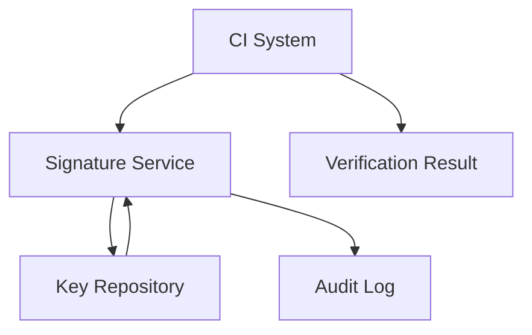

# Quantum-Safe Git (QSGit) – System Architecture

## Overview

QSGit implements a **modular, cloud-native** architecture that combines low-level Git hooks with a high-performance signature service, a rich UI, and enterprise-grade security layers.

### Core Components

| Component | Technology | Responsibilities |
|-----------|------------|------------------|
| **Git Hooks Plugin** | Rust (libgit2) | Intercepts `commit`, `push`, `tag` events; auto-signs with PQC. |
| **Signature Service** | Go + gRPC | Manages key storage, signs/verifies, provides API endpoints. |
| **Key Repository** | HSM / Cloud KMS | Stores signing keys securely (YubiKey, AWS KMS, Azure Key Vault, TPM). |
| **Central Audit Log** | Elasticsearch + Kafka | Immutable logs of all signing events. |
| **Policy Engine** | Go (OPA) | Enforces organization-wide signing policies. |
| **Desktop UI** | Electron + React | Visual verification, key management, status dashboard. |
| **IDE Extensions** | Language Server Protocol | Real-time signature status in VS Code, IntelliJ, etc. |
| **CLI Tools** | Rust / Go | Command-line utilities for verification, key generation, migration. |
| **CI/CD Integration** | GitHub Actions, GitLab CI, Jenkins | Automated verification in pipelines. |
| **Monitoring** | Prometheus + Grafana | Real-time metrics, alerts, dashboards. |

### Data Flow

1. **Local Signing**  
   - Git hook → Signature Service (gRPC) → Key Repository → PQC signature embedded in commit.

2. **Verification**  
   - CI or local tool → Signature Service → Public key lookup → Signature validation → Audit log.

3. **Audit & Monitoring**  
   - Every signing/verification event is written to Elasticsearch.  
   - Prometheus scrapes metrics (signing rate, latency, errors) → Grafana visualizes.

### Interaction Diagrams

#### Commit Signing Flow

```mermaid
graph TD
    U[Developer] --> GH[Git Hook (Rust)]
    GH --> SS[Signature Service (Go)]
    SS --> KR[Key Repository (HSM/Cloud)]
    KR --> GH
    GH --> C[Commit with Embedded Signature]
```

#### Verification Flow



### Deployment Architecture

- **Local Developer Environment** – Git hooks, Desktop UI, CLI tools.
- **Enterprise Cluster** – Signature Service + Key Repository (Kubernetes Deployments, StatefulSets).
- **Observability Stack** – Prometheus (metrics), Grafana (dashboards), Elasticsearch (logs), Alertmanager (alerts).

### High Availability & Scaling

- **Signature Service** can be horizontally scaled via Kubernetes Deployments; load balancing is handled by Ingress controllers.
- **Key Repository** uses a combination of replicated HSMs (for on-prem) or cloud KMS (for SaaS) with automatic fail-over.
- **Audit Logging** employs a distributed Kafka → Elasticsearch pipeline for write-once, read-anywhere semantics.

### Security Considerations

- **TLS everywhere** – Mutual TLS (mTLS) between components.
- **Principle of Least Privilege** – Git hooks run with minimal permissions; Signature Service only accesses required key material.
- **Key Rotation** – Automated policies can enforce periodic key rotation via HSM or cloud KMS APIs.
- **Immutable Audit Trail** – Logs are written to Write-Once storage (e.g., AWS S3 Object Lock) to prevent tampering.

### API Contract

The **Signature Service** exposes a gRPC API defined in `proto/qsg.proto`:

```protobuf
syntax = "proto3";

service QsgService {
  rpc SignObject (SignRequest) returns (SignResponse);
  rpc VerifyObject (VerifyRequest) returns (VerifyResponse);
  rpc GetPublicKey (PublicKeyRequest) returns (PublicKeyResponse);
}

message SignRequest {
  bytes payload = 1;
  string author = 2;
  int64 timestamp = 3;
}

message SignResponse {
  bytes signature = 1;
  string algorithm = 2;
  int64 signed_at = 3;
}

message VerifyRequest {
  bytes payload = 1;
  bytes signature = 2;
  string key_id = 3;
}

message VerifyResponse {
  bool valid = 1;
  string error_message = 2;
  // Optional: details like signer identity, timestamp
}

message PublicKeyRequest {
  string key_id = 1;
}

message PublicKeyResponse {
  string public_key = 1;
  string algorithm = 2;
  string created_at = 3;
}
```

Clients (Git hooks, CLI, UI) generate a gRPC channel, authenticate via TLS client certificates, and call these endpoints.

### Operational Procedures

#### Key Management
- **Generating a New Key**: `qsg-genkey --algorithm dilithium3 --output ./keys/user1`
- **Rotating a Key**: `qsg-genkey --rotate --key-id user1 --output ./keys/user1_new`
- **Importing from Hardware**: `qsg-import --source yubikey:// --key-id hardware1`

#### Running Locally
```bash
# Start signature service (in one terminal)
docker compose up -d signature-service

# Add git hook plugin (copy binary to ~/.git_ext)
cp target/debug/git_hook ~/.git_ext/

# Launch desktop UI
npm run start --prefix ui/
```

#### Running in Production (Kubernetes)
```bash
# Deploy via Helm
helm install qsg ./helm/qsg \
  --set image=yourrepo/qsg-signature:latest \
  --set keyRepository.type=cloud \
  --set keyRepository.cloud.provider=aws

# Verify signing works
git commit -m "test" && git verify-signature
```

### Monitoring & Alerting

| Metric | Description |
|--------|-------------|
| `signing_requests_total` | Total number of signing requests processed |
| `verification_requests_total` | Total verification attempts |
| `signing_latency_seconds` | Histogram of signing latency |
| `verification_latency_seconds` | Histogram of verification latency |
| `key_rotation_events_total` | Count of automatic key rotations |
| `audit_log_entries_total` | Number of logged events |

Alerts are defined in `prometheus/alerts.yml`:

```yaml
groups:
- name: qsg_alerts
  rules:
  - alert: HighSigningLatency
    expr: histogram_quantile(0.95, qsg_signing_latency_seconds) > 0.5
    for: 5m
    labels:
      severity: warning
    annotations:
      summary: "High signing latency detected"
      description: "Average signing latency is {{ $value }} seconds"
